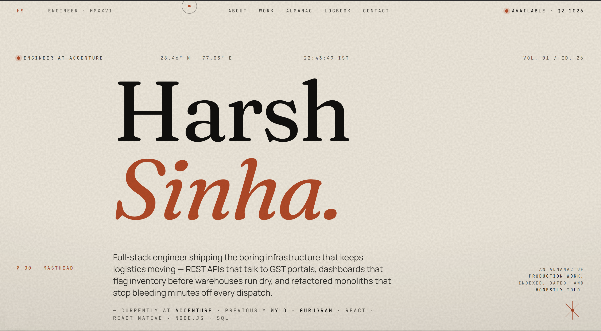

  

  
  
  
  

  

---

### `§ 01 — ALMANAC`

   
  

### `§ 02 — LEDGER`

  

  
  

### `§ 03 — CONTRIBUTIONS`

  

<code>AN ALMANAC OF PRODUCTION WORK, INDEXED, DATED, AND HONESTLY TOLD. ✳</code>

